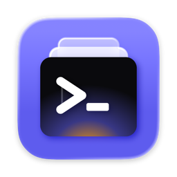

<div align="center">



# Workdeck

**Your Claude Code limits and sessions in the MacBook notch — and a Mac that stays awake with the lid closed.**

A minimal macOS menu bar toolbox for developers. Native SwiftUI, no account, no telemetry.


</div>

---

## Why

A Claude Code plan limit runs out in the middle of a task, a session sits waiting for a permission in a window you are not looking at, and a long build stops the moment you close the lid. Workdeck puts all of it in one place: the notch shows how much of your limits is left and what every session and agent is doing, and the menu bar keeps the Mac awake when you need it to.

## Features

- 💻 **Closed-Lid Mode** — keeps the Mac awake with the lid closed, for long builds, SSH sessions or a working Mac in a bag. Turns itself off on low battery or when the Mac gets too hot, and sleep always comes back on quit, crash or restart. [More](docs/closed-lid-mode.md)
- 📊 **Claude Code limits in the notch** — a ring and the percent of the window closest to its limit; hover for both windows with reset times and a forecast (`runs out ~16:40 · resets 18:00`). [More](docs/claude-code.md#limits)
- 🤖 **Live sessions and agents** — every session working, waiting for you or idle, its agents as a tree, the focused session's last steps as a ticker, and each edit's `+12 −3`. [More](docs/claude-code.md#sessions)
- 🔔 **Alerts that come to you** — a limit at 80 % and 95 %, a limit that reset, a session that needs you, a long session that finished. The notch opens with the alert, glows in its color, then flashes once.
- 🎯 **Back to the right window** — click a session to bring forward its VS Code, Cursor or Windsurf window, or its own Terminal or iTerm2 tab.
- 📅 **Weekly recap and Statistics** — last week's coding time by project, sessions, files, lines, commands, agents and limit hits on the first unlock of a week; any of the last twelve weeks in a window. Counts and names only, stored locally. [More](docs/claude-code.md#weekly-recap-and-statistics)
- 👥 **Two accounts side by side** — run a second Claude Code instance with its own login, see both accounts' limits, and continue a chat on the other account when a limit runs out. [More](docs/claude-code.md#instances-and-chats)
- 🖥️ **Any display** — on an external monitor with the lid closed, a virtual notch at the top of the screen, or plain text in the menu bar.
- 🧪 **Demo mode** — a one-minute scripted tour in the notch, no Claude Code needed.
- 🔒 **Private by design** — prompts, answers and file contents are never stored; every change to a `settings.json` is shown as a diff first and backed up.

## Try It Without Claude Code

Open Settings from the gear in the popover and click **Try Demo** under General. For one minute the notch plays a scripted session: two accounts' limits, a session with a step ticker and an agent, a second session that needs you, a limit alert, a finished session and a weekly recap whose **Details…** open the Statistics window with twelve made-up weeks. Nothing is written to disk, and your real sessions are still tracked while it plays.

## Install

Workdeck is built from source; there is no signed download yet.

**Requirements:** macOS 26 or later, Xcode 27.

```bash
git clone https://github.com/LuckyWins/Workdeck.git
cd Workdeck
make install   # build, quit the installed Workdeck, copy it to /Applications, and launch it
```

Both the `Workdeck` and `WorkdeckHelper` targets are signed with team `J55BY69CVU`; with a different team, also update `teamIdentifier` in `Shared/HelperConstants.swift`. The build is signed with your Apple Development certificate and runs on your own Mac; it is not sandboxed, not notarized and not on the Mac App Store.

The first time you turn on Closed-Lid Mode, macOS asks you to approve Workdeck's helper: click **Open System Settings…** in the popover and allow Workdeck in **General → Login Items & Extensions**. See [Closed-Lid Mode](docs/closed-lid-mode.md#first-run).

## Setup

1. **Connect Claude Code.** Turn on Claude Code in the popover, or click **Connect…** in Settings. Workdeck shows the change to `~/.claude/settings.json` as a diff; after you confirm, it adds its status line command (limits) and saves a backup. A status line you already had keeps running after Workdeck's.
2. **Connect the session hooks** in Settings → Claude Code · Sessions to see sessions and agents. Again a diff first, then a backup; **Disconnect…** removes only Workdeck's entries.
3. **Optional:** only working in the Claude Code VS Code extension, whose panel does not run the status line? Turn on **Fetch usage from Anthropic (unofficial)**: it calls an undocumented endpoint with Claude Code's login token. Read the [risks](docs/claude-code.md#limits) first.
4. **Optional:** add a second account in Settings → Claude Code · Instances.

Claude Code reports plan usage only for Pro and Max subscriptions. Details: [docs/claude-code.md](docs/claude-code.md).

## Things to Try

| Do this | Workdeck does that |
|---|---|
| Hover the notch | opens with both limit windows and every session |
| Click a session in the notch | brings forward its editor window or terminal tab |
| Click a limit alert | opens Chats on that account, to go on with another one |
| Turn on **Notify when a session finishes** in Settings → Notch and start a long task | tells you when it is done, with how long it worked |
| Click **Statistics…** in the Claude Code row | shows this week's coding time by day and project |
| Turn on Closed-Lid Mode and close the lid | keeps the build running |
| Settings → General → **Try Demo** | plays the one-minute tour |

## How It Works

- **Closed-Lid Mode** needs the root-only `SleepDisabled` power setting (`pmset -a disablesleep 1`); `caffeinate`'s power assertions do not prevent clamshell sleep. A small launchd helper registered with `SMAppService` can only set it to 0 or 1, accepts XPC connections only from Workdeck signed by the same team, and restores sleep on every exit path. [Details](docs/closed-lid-mode.md#how-it-works)
- **Limits** come from Claude Code's status line: `workdeck-statusline` writes the usage it receives to a snapshot file that the app watches.
- **Sessions** come from asynchronous Claude Code hooks: `workdeck-hook` keeps an allowlist of fields (event, IDs, project folder, tool name and a short target, line counts) in one file per session.
- **The notch** is drawn with [DynamicNotchKit](https://github.com/MrKai77/DynamicNotchKit) in a terminal style; the recap and Statistics read daily totals from `recap.json`.

## Privacy

- No account, no analytics, no telemetry. The only network call is the opt-in usage endpoint, to Anthropic.
- Prompts, answers, file contents and chat titles are never stored or logged; tool calls keep only the tool name, a short target with secret-looking values masked, and line counts.
- The login token is read from your Keychain only for the opt-in usage call; it is never refreshed, stored or logged.
- Every `settings.json` change is shown as a diff before it is written; `settings.json` and `~/.zshrc` are backed up before Workdeck changes them.

<details>
<summary><b>Troubleshooting</b></summary>

- **Is sleep disabled right now?** `pmset -g | grep SleepDisabled` — no output means sleep works normally. If it ever stays disabled: `sudo pmset -a disablesleep 0`.
- **Helper logs:** `/usr/bin/log stream --predicate 'subsystem == "com.appcreators.workdeck.helper"'`.
- **"Couldn't change the sleep setting" after rebuilding in Xcode:** launchd may still run an older helper build; turn Workdeck off and on again in Login Items & Extensions.
- **Claude Code:** Settings → About → **Copy Diagnostics** copies Workdeck's recent log and current state, without prompts, answers or tool details.

More in [Closed-Lid Mode](docs/closed-lid-mode.md#troubleshooting) and [Claude Code](docs/claude-code.md#troubleshooting).

</details>

<details>
<summary><b>Uninstalling</b></summary>

1. Turn off Closed-Lid Mode, disconnect Claude Code in Settings (restores your status line and removes the hooks), and quit Workdeck.
2. In **System Settings → General → Login Items & Extensions**, turn off Workdeck.
3. Delete `Workdeck.app`.

</details>

<details>
<summary><b>Building and project structure</b></summary>

```bash
make build     # Release build into ./build
make test      # run the unit tests
make install   # build, quit the installed Workdeck, copy it to /Applications, and launch it
               # (stops with an error if Workdeck is running from Xcode — stop it there first)
make clean     # remove ./build
```

Or open `Workdeck.xcodeproj` and run the `Workdeck` scheme. macOS ties the helper approval to the app's location: after the first `make install`, approve Workdeck again in Login Items & Extensions; the copy Xcode runs from DerivedData stays listed there as a separate entry and can be turned off.

```
Workdeck/          Menu bar app (SwiftUI)
  App/             Scenes and top-level views
  Core/            Helper client and installer, settings, demo mode
  Features/        One folder per tool
WorkdeckHelper/    Privileged launchd helper
Shared/            Code compiled into both the app and the helper
LaunchDaemons/     launchd job definition embedded in the app bundle
ClaudeUsage/       Code shared by the app and the status line command
WorkdeckStatusLine/ Claude Code status line command (workdeck-statusline)
ClaudeHooks/       Code shared by the app and the hook command
WorkdeckHook/      Claude Code hook command (workdeck-hook)
WorkdeckTests/     Unit tests (Swift Testing)
specs/             Design specs
plans/             Implementation plans
docs/              Feature details, media and the manual testing checklist
```

</details>

## Credits

The notch is drawn with [DynamicNotchKit](https://github.com/MrKai77/DynamicNotchKit) (MIT). Several ideas, from the step ticker to the weekly recap and the demo mode, were inspired by [Coucou](https://github.com/Louis-CFM/coucou), an open notch companion for AI coding agents.

## License

[MIT](LICENSE). "Claude" and "Claude Code" are trademarks of Anthropic; Workdeck is an independent project that works with Claude Code.
