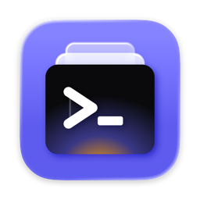
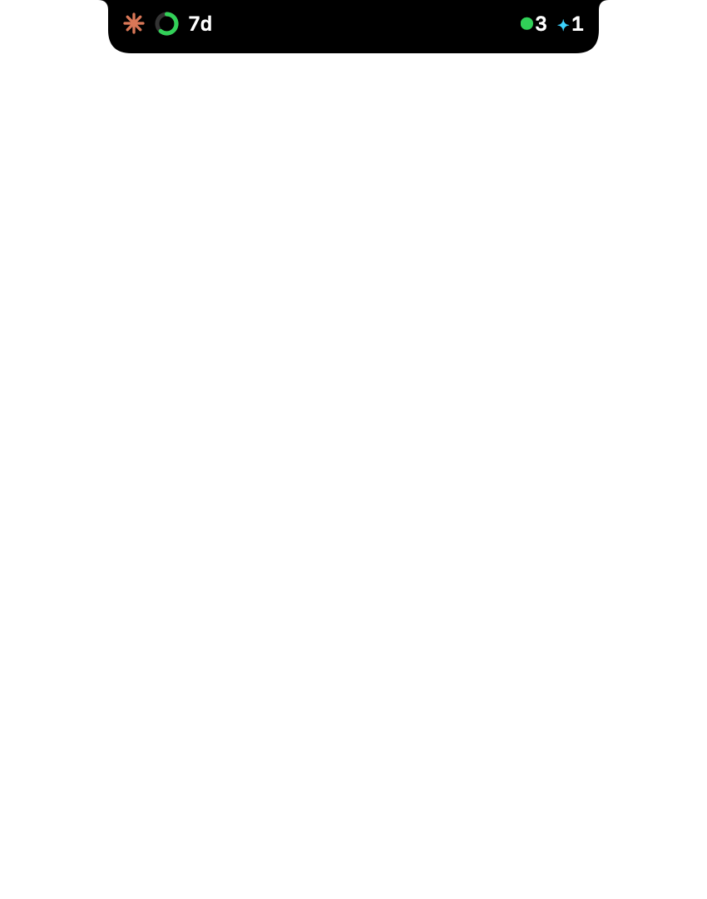

<div align="center">



# Workdeck

**Limits, sessions and alerts in the MacBook notch, for Claude Code and Codex — and a Mac that stays awake with the lid closed.**

A minimal macOS menu bar toolbox for developers. Native SwiftUI, no account, no telemetry.




</div>

## Features

- 📊 **Limits and sessions in the notch** — every account's 5-hour and weekly limits with a forecast, and every session of Claude Code and Codex with its agents, last steps and changed lines; on an external display a virtual notch. [More](docs/claude-code.md)
- 🔔 **Alerts that come to you** — a session that finished or waits for a permission, a limit running low; click to jump to its window. [More](docs/claude-code.md#sessions)
- 👥 **Out of limit? Switch accounts** — run a second Claude Code account and carry a chat on to it in one click. [More](docs/claude-code.md#instances-and-chats)
- 💻 **Close the lid, the work goes on** — Closed-Lid Mode keeps the Mac awake with the lid closed: agents, builds and SSH finish while you're away. [More](docs/closed-lid-mode.md)
- 📝 **Quick notes to Reminders** — tap the right Option key, type, press Return; `#` picks a project, a date sets a reminder, ⌘↩ gives the note to Claude Code or Codex. [More](docs/quick-notes.md)
- 📅 **Your week at a glance** — a recap on the first unlock of each week, and half a year of work in Statistics. [More](docs/claude-code.md#weekly-recap-and-statistics)
- 🔀 **Every account, set up alike** — see which skills, MCP servers, plugins and `CLAUDE.md` each account has, and copy what's missing. [More](docs/claude-code.md#instances-window)

Codex has [its own page](docs/codex.md). The tour with pictures, things to try and more: [Install and Get Started](docs/install.md).

## Install

```bash
curl -fsSL https://luckywins.github.io/Workdeck/install.sh | bash
```

Paste it in Terminal: it downloads the latest version into Applications, checks it is signed by Workdeck's team and opens it. macOS 26 or later; Workdeck offers later versions in the app. [More](docs/install.md#install)

## Getting Started

1. Turn on Claude Code (or Codex) in the menu bar popover, then **Connect…** the status line and session hooks in Settings. You see the exact change to its settings file first, and a backup is kept.
2. Want a look first? Settings → General → **Try Demo** plays a one-minute tour with made-up data.

[Setup in detail](docs/install.md#setup)

## Privacy

No account, no telemetry. Prompts, answers and file contents are never stored; every change to a `settings.json` is shown as a diff before it is written; the root helper of Closed-Lid Mode does one thing, turning sleep off and on. [The full list](docs/install.md#privacy)

## Building from Source

```bash
git clone https://github.com/LuckyWins/Workdeck.git
cd Workdeck
make install
```

Requires Xcode 27. Signing, `make` targets and the project's layout: [Building from Source](docs/install.md#building-from-source).

## Credits

The notch is drawn with [DynamicNotchKit](https://github.com/MrKai77/DynamicNotchKit) (MIT). Several ideas, from the step ticker to the weekly recap and the demo mode, were inspired by [Coucou](https://github.com/Louis-CFM/coucou), an open notch companion for AI coding agents.

## License

[MIT](LICENSE). "Claude" and "Claude Code" are trademarks of Anthropic; Workdeck is an independent project that works with Claude Code.
