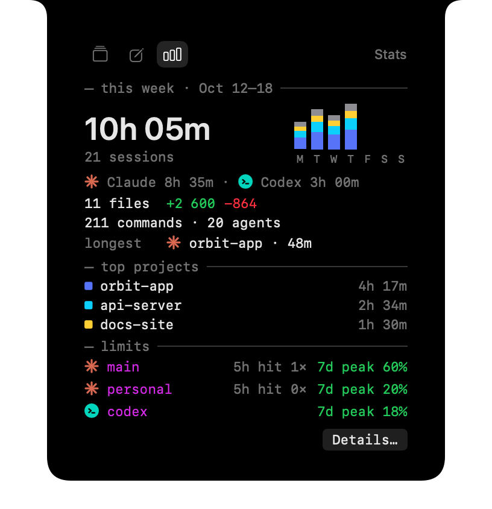
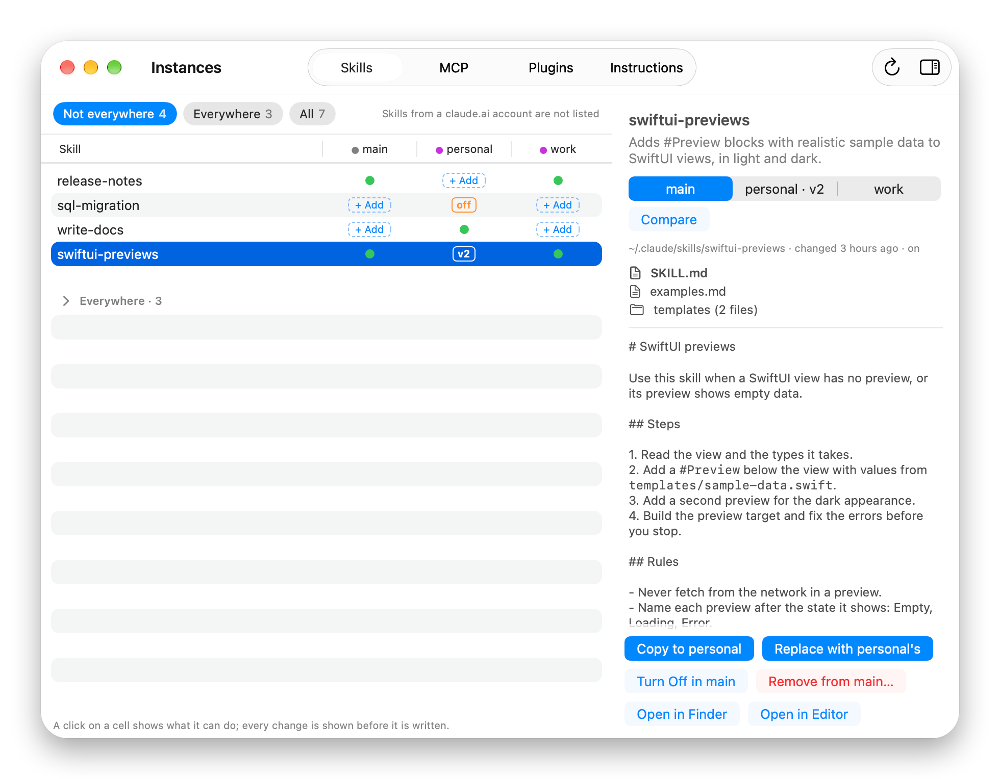

# Claude Code

Workdeck's Claude Code tool: plan limits and live sessions in the notch, alerts, the weekly recap and Statistics, a demo, and extra accounts. The [README](../README.md) has the overview and setup.

## Limits

Shows how much of your Claude Code plan limits you have used — the 5-hour window and the weekly window — in the MacBook notch, Dynamic Island style.

- The compact view shows a ring for the window closest to its limit; from the first threshold on the percent follows it, e.g. `84%` (labeled `7d 91%` when the weekly window is closer); hover to expand a terminal-style panel with a usage bar per window and when it resets.
- The expanded notch has three tabs at the top: **Sessions** (the limits and sessions described here), **Notes** (the [quick notes](quick-notes.md) panel, with the cursor in its line) and **Stats** (this week so far, as the weekly recap shows it, with **Details…** for the Statistics window). Hovering always opens it on Sessions; alerts and the weekly recap card show without the tabs.
- **Show** (Settings → Notch): "Always", or "When active": the notch appears while a session works or waits for you and while a limit is near, stays a minute after work ends, and shows when you point at its place. Hovering waits a moment before expanding and before collapsing, so passing the pointer by does not open it.
- Alerts at two thresholds set in Settings → Notch (80 % and 95 % by default) and, optionally, when a limit you came close to resets. A limit alert opens the notch with its text for a few seconds (`5-hour limit at 80%`, click it to open Chats), then flashes the compact notch's ring once in its color (orange, red, or green for a reset). The expanded alert glows from below in its color, and a thin bar shows how long it stays.
- If you reset your limits on claude.ai, the new figures show at the next poll or refresh when Fetch usage from Anthropic is on, and after a few messages otherwise. When an instance signs in to another account, its limits start over: the old account's figures are not shown, and alerts already shown are not repeated.
- Below the first threshold the compact notch shows the ring alone (and `7d` when the weekly window is the most used); the percent appears with the orange ring. An extra account shows as its letter in a purple badge, and with Codex on too the agent's icon comes first.
- A forecast in the expanded view, e.g. `runs out ~16:40 · resets 18:00`, when a limit will run out before it resets at your current pace (can be turned off in Settings → Notch).
- On a screen without a notch (an external display with the lid closed) the same notch is drawn at the top center of the main display as a virtual notch, and it hides while that display shows a full-screen app (alerts still appear). Settings → Notch → **Without a notch** switches to text next to the Workdeck icon in the menu bar instead.
- On a Force Touch trackpad the notch taps lightly when it opens under the pointer, and a little stronger when an alert that asks for attention comes up (needs you, a limit threshold, a finished session; a limit reset does not). Settings → Notch → **Haptic feedback** turns it off.

**Connecting to Claude Code.** Turn on Claude Code in the popover (or click **Connect…** in Settings). Settings shows the change to each `settings.json` as a diff; after you click **Connect**, Workdeck adds its status line command to `~/.claude/settings.json` and saves a backup as `~/.claude/settings.json.workdeck-backup`. Only the `statusLine` key changes, but the file is re-written, so key order and formatting may change. If you already had a status line, Workdeck keeps running it and shows its output after the usage, e.g. `5h 42% · main`. **Disconnect…** in Settings shows its diff the same way and restores your previous status line.

**Limitations.** Claude Code reports plan usage through the status line only for Claude Pro and Max subscriptions, and only while a Claude Code session runs in a terminal (after the first response). The graphical panel of the Claude Code VS Code extension does not run the status line. Between sessions Workdeck shows the last known values and how old they are.

**Working only in the VS Code extension.** Turn on **Fetch usage from Anthropic (unofficial)** in Settings. Workdeck then reads the login token Claude Code stores in your Keychain (through the system `security` tool, so macOS does not ask for your password) and calls an undocumented Anthropic endpoint every 5 minutes, when you open the popover (at most once a minute), and when you click the refresh button in the expanded notch. Polling pauses while the screen is locked or asleep and catches up when you unlock. Workdeck never refreshes or stores the token. Anthropic's terms do not allow third-party use of Claude Code credentials, and the endpoint may change or stop working at any time; use this at your own discretion. Only Claude Code renews its login: while Claude Code is closed, or open but idle for hours, the token expires, and Workdeck stops calling the endpoint and shows "waiting for Claude Code" with the last figures until Claude Code runs again.

## Sessions

Connect **Session hooks** in Settings to see every live Claude Code session in the expanded notch: whether it is working, waiting for you (a permission prompt), or idle, and which subagents are running inside it. The compact notch shows how many sessions are live (`●2`, orange when one waits for you) and how many subagents are running (`✦3`). In the expanded panel, agents appear as a tree under their session with a spinner, and working sessions pulse. File edits show the lines they added and removed (`+12 −3`), each session ends with its turn's total (`this turn · 5 files +84 −21`, `last turn` once it stops), and the session that most recently started working shows its last three steps, the current one brightest. Click a session to bring it to the front: VS Code, Cursor and Windsurf open the project's window; Terminal and iTerm2 show the session's own tab (macOS asks once whether Workdeck may control them); other terminals are activated.

Workdeck adds asynchronous hooks for `SessionStart`, `SessionEnd`, `UserPromptSubmit`, `PostToolUse`, `Notification`, `Stop`, `SubagentStart`, `SubagentStop`, `PreToolUse`, `PreCompact` and `StopFailure` (a turn cut short by an API error, such as a plan limit, ends with it instead of `Stop`) to `~/.claude/settings.json` (with the same backup as the status line). The hook command, `workdeck-hook`, keeps only the event name, session and agent IDs, tool call IDs, the project folder, the agent type and task description, and which app hosts the session, in `~/Library/Application Support/Workdeck/sessions` (one file per session, deleted when the session ends and trimmed to its newest events above 1 MB). Prompts and answers are never stored; for tool calls only the tool name, a short target (file name, start of a command with secret-looking values masked, domain, search text) and, for file edits, how many lines were added and removed are kept. **Disconnect…** shows the diff and removes only Workdeck's hooks.

Claude Code sends no hook when you press Esc or answer "No" to a permission prompt, and in VS Code it sends no idle notification afterwards either. So when a working or waiting session has been quiet for a few seconds, Workdeck looks at the end of its transcript (`<session>.jsonl` in the instance's `projects` folder) for Claude Code's `[Request interrupted by user]` line; finding one from the current turn turns the session idle within about 10 seconds, without a "finished" alert. Only that line's time is read; nothing from the transcript is stored or logged.

While a session works, its row shows what it is doing (`Bash xcodebuild -sch…`, `Read NotchPresenter.swift`), and agents show their own current step. Optional, all off by default in Settings → Notch (they apply to every agent): **Keep Mac awake while an agent works** (a standard power assertion, visible in `pmset -g assertions`; the display still sleeps and a closed lid still sleeps unless Closed-Lid Mode is on), **Notify when a session finishes** after it worked for at least the chosen time (10 minutes by default), which opens the notch with `<project> finished · worked 14m` for a few seconds (click it to bring the project's window forward) and then flashes the session dot green, and **Notify when a session needs you**, which opens the notch with the project's name for a few seconds (click it to bring the project's window forward) and then blinks the dot orange. Alerts are skipped while that session's app is in front.

## Weekly Recap and Statistics

While it runs, Workdeck keeps daily totals of your Claude Code and Codex work in `~/Library/Application Support/Workdeck/recap.json` for 26 weeks: coding time (parallel sessions merged), sessions, edited file names, lines, commands, agents, and per account how often the 5-hour limit reached 100% and the weekly peak. Only counts and project and file names, no paths, prompts or contents. On the first unlock of a new week the notch shows last week's recap for about a minute, then keeps a `◆` until you click **Got it**; **Details…** opens that week in the Statistics window. The chart button in the popover's header opens a window with any of the last 26 weeks, the current one by default: total coding time with the daily average and a comparison with the same days of the week before, a Monday–Sunday chart by project, every project with its sessions, files and lines, and the limits per account. Above the week, an activity grid shows every kept day as a square, one column per week (Monday at the top), green by coding time: under 1 hour, 1–3 hours, 3–6 hours, 6 hours or more (hover the legend for the scale). Hovering a square shows the day, its time and its top three projects; clicking any square opens its week below, and the shown week is outlined. Under the grid, the current streak (days in a row with coding time, counting today once you have worked and otherwise ending yesterday) and the active days in the grid. Days before Workdeck started recording are empty. A week with less than 15 minutes of work has no recap, and the recap appears only in the notch (the real one or the virtual one), not with the menu bar text or every agent off.

When both agents worked that week, the card adds a line such as `Claude 10h 05m · Codex 4h 10m`, each after its agent's icon, under the sessions: each agent's own time, so the two can add up to more than the coding time above them, which counts an hour both agents worked at once only once. The longest work carries its agent's icon, and Codex's weekly peak follows Claude Code's accounts as `codex` after its icon. In the Statistics window `All · Claude Code · Codex` then filters everything (activity grid, header, chart, projects, work, limits) to one agent's own work; it opens on All.

## Demo mode

Settings → General → **Try Demo** plays a one-minute scripted tour in the notch without Claude Code: two accounts' limits, a session with a step ticker and an agent, a second session that needs you, a limit alert, a finished session and a weekly recap; **Details…** on the recap opens the Statistics window with 26 made-up weeks. It stops by itself after the minute (Settings and the popover show the seconds left); **Stop Demo**, or **Stop** in the popover, ends it sooner. Nothing is written to disk; your real sessions are still tracked and their alerts are skipped while it plays.

## Instances and Chats

Run a second Claude Code account side by side. In Settings → Claude Code · Instances, **Add Instance…** creates `~/.claude-<name>` (its own login, settings, skills and plugins — Workdeck copies none of them unless you ask for it in the Instances window below), adds `alias claude-<name>='CLAUDE_CONFIG_DIR="$HOME/.claude-<name>" claude'  # Workdeck` to `~/.zshrc` (backup: `~/.zshrc.workdeck-backup`), and opens Terminal so you can `/login`. **Remove…** deletes only that alias line; the folder and its login stay.

**Chats…** in the popover lists the chats of every instance by project, with their titles (a renamed chat shows its new name; read from the transcripts, shown only in the window, never stored or logged). **Terminal** (on hover) asks which account to open the chat with; another account gets the chat's transcript linked in with a hard link (a second name for the same file, so both accounts list it), then Terminal opens with `claude --resume`, so a chat goes on with the other account when a plan limit runs out; both instances then share one transcript. Workdeck warns before continuing a chat that is open somewhere else: writing to it from two places corrupts it. **Unlink** removes only the link. **VS Code** (on hover) asks for the account the same way and opens the chat's project in a VS Code profile named `Claude <instance>`, whose Claude Code extension runs on that account; set the profile up once with the steps behind **VS Code…** in the instance's row in Settings, then pick the chat in the Claude panel's history. Clicking that account's session in the notch later brings this window forward, not a second window of the folder. Hovering a project's header offers **Terminal** and **VS Code** for a new chat in that project, and its `…` menu sets the project's **Default Account**: Terminal and VS Code, on the header and on its chats, then open on that account without asking, until it is set back to Ask Each Time.

With more than one instance, every instance gets Workdeck's status line and session hooks (`workdeck-statusline --instance <name>`, `workdeck-hook --instance <name>` in its own `settings.json`, with a backup), connected and disconnected together with the main one; instances added earlier are connected on the next launch. The expanded notch shows one limits block per account, the compact notch shows the account of your latest session as its letter in a purple badge (`P`; nothing for the main account), and sessions of an extra account carry a purple account tag. With "Fetch usage from Anthropic" on, each account is polled with its own Keychain item.

## Instances window

Compare what your Claude Code instances have and carry an item from one to another without asking an agent to do it. Open it with **Instances…** in the Claude Code row of the popover (it appears once there is a second instance) or **Compare…** in Settings → Claude Code · Instances.

<picture><source media="(prefers-color-scheme: dark)" srcset="media/screenshots/instances-dark.png"></picture>

One column per instance, main first, and one row per item on four tabs: **Skills**, **MCP**, **Plugins** and **Instructions** (each instance's `CLAUDE.md` first, then the files under `rules/`, which may be a link to a dotfiles folder). The chips filter the rows: **Not everywhere** (the default), **Everywhere** and **All**; rows that are the same in every instance are folded under `Everywhere · N`. With one instance the window says that comparing needs a second one.

A cell shows what that instance has:

- `●` it has the item as it should be; a plugin shows its version.
- `off` it has the item but turned off: a skill set to `off` in `skillOverrides`, a plugin that is not enabled, an MCP server disabled in its project.
- `v2` (skills) or `differs` it has the same name with other contents; the reference is the first instance, in column order, that has it on.
- `+ Add` or `+ Install` it lacks the item.
- `folder gone` an MCP server of a project whose folder no longer exists; nothing can be added there.
- `Couldn't read` a file of that instance is unreadable or not valid JSON; the other columns still work.

**Skills** are the own skills in `skills/<name>/` (a plugin's skills are listed under Plugins, and a claude.ai account's skills are not listed). Two copies are the same when a hash of their files is, up to 200 files and 5 MB per skill; hidden files and folders such as `.git` are left out. A bigger skill is compared by its `SKILL.md` only and says so in its cell's tooltip and in the inspector. Select a row to read the skill on the right: its name and description, path, when it changed, its files, and `SKILL.md` as text. When copies differ, a switch picks whose copy is shown and **Compare** shows what changed in `SKILL.md` and which other files differ. **Open in Finder** and **Open in Editor** are there too, and the inspector can be hidden with the button in the toolbar.

**MCP** lists the servers of the whole instance first and the servers of projects below, grouped by project, each with its type and command or URL. A server's `env` values and headers can hold secrets: they are never shown (`API_TOKEN=•••`), not in a row, a review or a log. In its command line and URL Workdeck also hides the value of a flag or `NAME=value` with a secret-looking name (`--api-key`, `--pat`, `-p` unless it is a port, `API_TOKEN=`, a password in a connection string), every `--header` value, the values of secret-looking keys in a JSON argument, values in a known token format (`ghp_…`, `sk-…`, `xoxb-…`, `AKIA…`, a JWT and others), the password in `user:password@host`, a value with `Bearer` in it and the word after a `Bearer`, the user part of a URL, a random-looking part of its path and its query and fragment values. An argument that is itself a command line, such as the script of `sh -c`, is masked word by word. Anything else in the command line is shown as written. Hidden values are still compared, so a server whose secret changed shows `differs`. **Plugins** lists the plugins installed for the whole instance; **Browse Plugins…** shows every plugin of every marketplace any instance knows, with search, categories and a checkbox per instance, and **Add Marketplace…** takes a GitHub `owner/repo` or a URL.

**The cell menu.** Click any cell for what that copy can do; the inspector shows the same actions for the copy it shows. Every action first shows what will change, and nothing is written before you click **Confirm**.

- A cell that has the item offers, in order: turning it on or off in that instance (skills and plugins), **Copy to** each instance that lacks it or (skills and instructions) has other contents, **Replace with <instance>'s** for each other version, and **Remove from <instance>…** (**Uninstall from…** for a plugin). An MCP server is copied only where it is missing, and an off plugin offers only **Enable** and **Uninstall…**. A copy's review says when the skill will arrive turned off (its `skillOverrides` entry in the target) and when the target's `skills` folder is shared with another instance, which gets the copy too. If `settings.json` changed between the review and **Confirm**, the review shows the new changes instead.
- A `+ Add` or `+ Install` cell offers **Copy from** each instance that has the item, once per version.
- **Turning a skill on or off** changes its entry in that instance's `skillOverrides` in `settings.json`: off sets it to `"off"`, on removes it. The review shows the file's diff (secret-looking values masked) and says when Workdeck also re-sorts and re-indents the file, a backup goes to `settings.json.workdeck-backup`, and a file that changed after the review is left alone. An instance whose `settings.json` is the same file as another's (a symbolic link) cannot turn a skill on or off here: the item says which instance it shares the file with.
- **Removing** a skill, `CLAUDE.md` or a rule moves it to the Replaced folder below, never deletes it (a linked skill moves as a link). An instance whose `skills` folder is shared with another, or whose skill or file another instance links to, cannot remove it here: the item says which instance would lose it. When there is nothing to change any more (the file changed since the window read it), the window reads the instances again.
- **Plugins and MCP servers** are turned on, off and removed by Claude Code in Terminal: `claude plugin enable|disable <plugin> --scope user`, `claude plugin uninstall <plugin> --scope user --keep-data` (the plugin's data folder stays) and `claude mcp remove <name> --scope user` (`--scope local` in the project's folder for a project's server; not offered once that folder is gone).

**Copying.**

- A skill, `CLAUDE.md` or a rule is copied by Workdeck itself, into a hidden temporary name next to the target and then renamed, so a failed copy leaves nothing half-written. A copy it replaces is first moved to `~/Library/Application Support/Workdeck/Replaced/<instance>/<date>/…` (the **Replaced folder**), so nothing is lost. A copy keeps the on or off state the target already had.
- Plugins and MCP servers are installed by Claude Code, not by Workdeck, which never writes Claude Code's JSON files: Terminal opens and runs `claude plugin install <plugin>@<marketplace> --scope user` (after `claude plugin marketplace add` when the target does not know the marketplace) or `claude mcp add-json <name> <json> --scope user` (`--scope local` in the project's folder for a project's server), for an extra instance with `CLAUDE_CONFIG_DIR` set to its folder. An MCP server is on once it is added. If Terminal says `claude` is not found, install Claude Code's command first. The server's definition, secrets included, goes only into a private script that deletes itself when it starts. The window reads the instances again when you come back to it.
- Sessions already open in the target pick a change up the next time they start. Editing an item is not done here.

## Troubleshooting

- Settings → About → **Copy Diagnostics** copies Workdeck's recent log and current state (no prompts, answers or tool details). **Send Feedback…** opens an email to the developer in your mail app with the same report attached (Apple Mail) or shown in Finder and copied (other mail apps); you see it before you send it. Live log: `/usr/bin/log stream --predicate 'subsystem == "com.appcreators.workdeck"'`.
