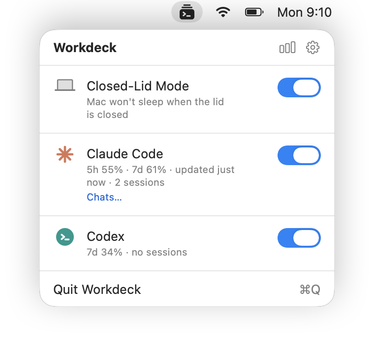
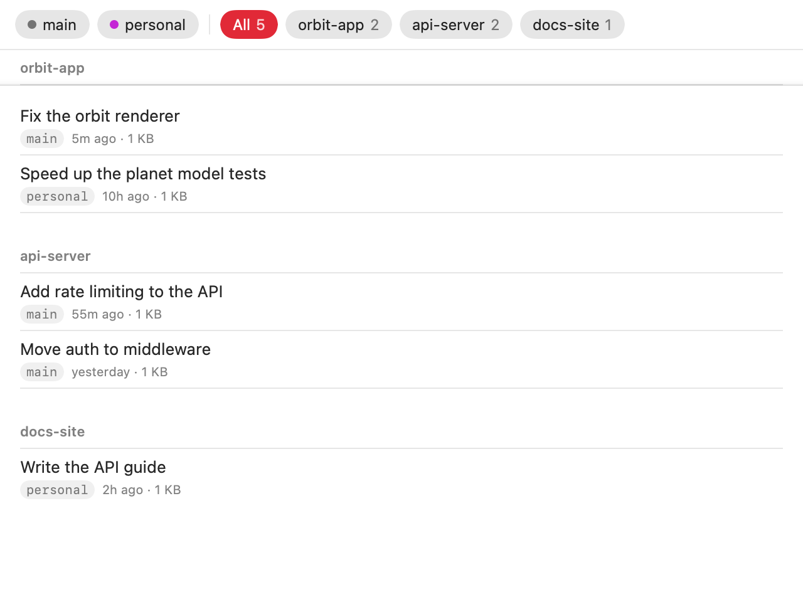
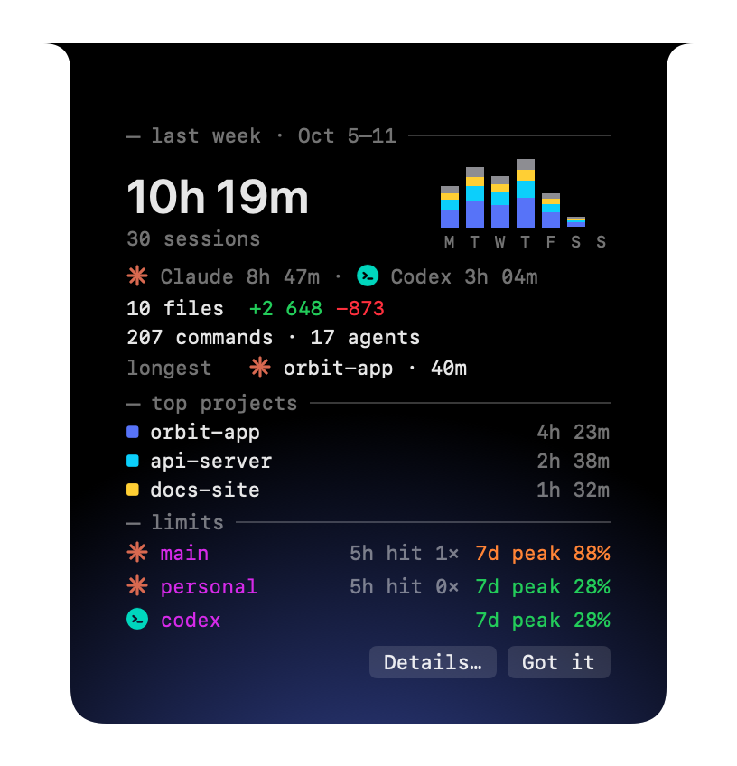
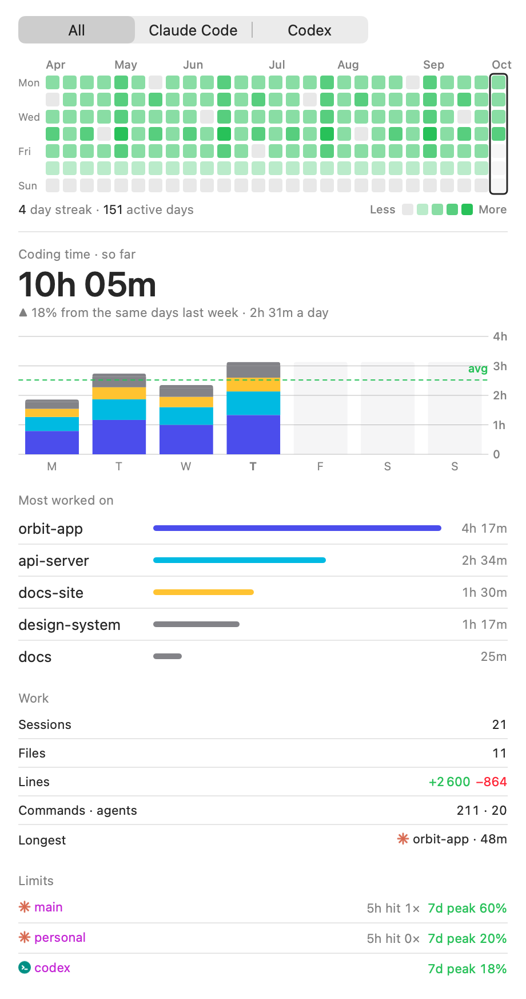

# Install and Get Started

[Install](#install) · [Updates](#updates) · [Setup](#setup) · [A Quick Tour](#a-quick-tour) · [Things to Try](#things-to-try) · [Try It Without Claude Code](#try-it-without-claude-code) · [Privacy](#privacy) · [Troubleshooting](#troubleshooting) · [Uninstalling](#uninstalling) · [Building from Source](#building-from-source)

## Install

Paste in Terminal:

```bash
curl -fsSL https://luckywins.github.io/Workdeck/install.sh | bash
```

It downloads the latest version into Applications, checks it is signed by Workdeck's team and opens it, with no "could not verify" prompt. macOS 26 or later. More on [the Workdeck page](https://luckywins.github.io/Workdeck/).

The first time you turn on Closed-Lid Mode, macOS asks you to approve Workdeck's helper: click **Open System Settings…** in the popover and allow Workdeck in **General → Login Items & Extensions**. See [Closed-Lid Mode](closed-lid-mode.md#first-run).

## Updates

With automatic checks on (Workdeck asks once, on its second launch), it looks for a new version on GitHub once a day: the notch says so once, the popover shows a row above Quit, and **Install** opens the standard update window, which installs it in place and relaunches. Settings → About → **Release notes** lists every version and what changed (from `CHANGELOG.md`).

## Setup

1. **Connect Claude Code.** Turn on Claude Code in the popover, or click **Connect…** in Settings. Workdeck shows the change to `~/.claude/settings.json` as a diff; after you confirm, it adds its status line command (limits) and saves a backup. A status line you already had keeps running after Workdeck's.
2. **Connect the session hooks** in Settings → Claude Code · Sessions to see sessions and agents. Again a diff first, then a backup; **Disconnect…** removes only Workdeck's entries.
3. **Optional:** only working in the Claude Code VS Code extension, whose panel does not run the status line? Turn on **Fetch usage from Anthropic (unofficial)**: it calls an undocumented endpoint with Claude Code's login token. Read the [risks](claude-code.md#limits) first.
4. **Optional:** add a second account in Settings → Claude Code · Instances.
5. **Optional:** turn on **Codex** in the popover to see its limits (it needs Codex signed in with ChatGPT), and connect its session hooks in Settings → Codex.
6. **Quick notes** need nothing set up: tap the right Option key and save a note; the first save asks for access to Reminders. See [Quick Notes](quick-notes.md).

Claude Code reports plan usage only for Pro and Max subscriptions. Details: [Claude Code](claude-code.md).

## A Quick Tour

<table>
  <tr>
    <td align="center" width="45%"><picture><source media="(prefers-color-scheme: dark)" srcset="media/screenshots/popover-dark.png"></picture></td>
    <td><b>1. Turn on what you need</b><br>Click the Workdeck icon in the menu bar. Each tool is one row: Closed-Lid Mode keeps the Mac awake with the lid closed, Claude Code and Codex show your limits and sessions. Connect them once in Settings.</td>
  </tr>
  <tr>
    <td align="center" width="45%"></td>
    <td><b>2. While you work</b><br>While a session is open the notch shows the limit closest to running out and how many sessions are working. It stays out of the way until something changes, and by default is empty when no session is open (Settings → Notch → Show).</td>
  </tr>
  <tr>
    <td align="center" width="45%"></td>
    <td><b>3. Hover to see everything</b><br>Rest the pointer on the notch: every account's 5-hour and weekly limits with reset times and a forecast, and every session with its agents, last steps and changed lines.</td>
  </tr>
  <tr>
    <td align="center" width="45%"></td>
    <td><b>4. When something needs you</b><br>A limit at 80 % or 95 %, a session waiting for a permission, a long session that finished: the notch opens with the alert. Click it to jump to the right window.</td>
  </tr>
  <tr>
    <td align="center" width="45%"><picture><source media="(prefers-color-scheme: dark)" srcset="media/screenshots/chats-dark.png"></picture></td>
    <td><b>5. Out of limit? Carry on with another account</b><br>Run a second Claude Code account side by side. In Chats, open any chat on the other account and continue where you stopped.</td>
  </tr>
  <tr>
    <td align="center" width="45%"></td>
    <td><b>6. Your week, on Monday</b><br>On the first unlock of a week the notch shows last week: coding time by project, sessions, files, lines and limit hits.</td>
  </tr>
  <tr>
    <td align="center" width="45%"><picture><source media="(prefers-color-scheme: dark)" srcset="media/screenshots/statistics-dark.png"></picture></td>
    <td><b>7. And everything before</b><br>Statistics keeps half a year: any week in detail, an activity grid of days and your streak, for Claude Code and Codex.</td>
  </tr>
  <tr>
    <td align="center" width="45%"></td>
    <td><b>8. Jot it down</b><br>Tap the right Option key, type, press Return: the note is a reminder in Apple Reminders, on your iPhone too. <code>#</code> and Tab pick the project, "tomorrow at 4pm" sets the reminder, ⌘↩ gives the note to Claude Code or Codex in the project's folder.</td>
  </tr>
</table>

## Things to Try

| Do this | Workdeck does that |
|---|---|
| Hover the notch | opens with both limit windows and every session, on the tab you last clicked |
| Click a session in the notch | brings forward its editor window or terminal tab |
| Click a limit alert | opens Chats on that account, to go on with another one |
| Turn on **Notify when a session finishes** in Settings → Notch and start a long task | tells you when it is done, with how long it worked |
| Click the chart button in the popover's header | shows this week's coding time by day and project |
| Tap the right Option key, type a note and press Return | saves it to Apple Reminders; `#wo` and Tab put it in a project |
| Press ⌘D on a note in the panel, then ⌘Z | ticks it, then takes the tick back before it is written |
| Turn on Closed-Lid Mode and close the lid | keeps the build running |
| Settings → General → **Try Demo** | plays the one-minute tour |

## Try It Without Claude Code

Open Settings from the gear in the popover and click **Try Demo** under General. For one minute the notch plays a scripted session: two accounts' limits, a session with a step ticker and an agent, a second session that needs you, a limit alert, a finished session, a Codex session working in parallel, a quick note typed into the panel and a weekly recap whose **Details…** open the Statistics window with 26 made-up weeks. Nothing is written to disk, and your real sessions are still tracked while it plays.

## Privacy

- No account, no analytics, no telemetry. The only network calls are the opt-in usage endpoint, to Anthropic, and the daily update check, to GitHub.
- Prompts, answers, file contents and chat titles are never stored or logged; tool calls keep only the tool name, a short description or target with secret-looking values masked, and line counts.
- The login token is read from your Keychain only for the opt-in usage call; it is never refreshed, stored or logged.
- Codex limits come from Codex's own session files and `codex app-server`; Workdeck never reads Codex's login.
- Quick notes live in Reminders and, once cleaned up, in a local archive; their text is never logged or kept anywhere else.
- Every `settings.json` change is shown as a diff before it is written; `settings.json` and `~/.zshrc` are backed up before Workdeck changes them.
- The weekly recap keeps counts, project and file names only, in a local file.
- Closed-Lid Mode's helper runs as root and does one thing: it turns the `SleepDisabled` power setting on or off for Workdeck signed by the same team. See [How It Works](closed-lid-mode.md#how-it-works).

## Troubleshooting

- **Is sleep disabled right now?** `pmset -g | grep SleepDisabled` — no output means sleep works normally. If it ever stays disabled: `sudo pmset -a disablesleep 0`.
- **Helper logs:** `/usr/bin/log stream --predicate 'subsystem == "com.appcreators.workdeck.helper"'`.
- **"Couldn't change the sleep setting" after rebuilding in Xcode:** launchd may still run an older helper build; turn Workdeck off and on again in Login Items & Extensions.
- **Claude Code:** Settings → About → **Copy Diagnostics** copies Workdeck's recent log and current state, without prompts, answers or tool details.
- **Tell the developer:** Settings → About → **Send Feedback…** opens an email in your mail app with the diagnostics attached; nothing is sent until you press Send.

More in [Closed-Lid Mode](closed-lid-mode.md#troubleshooting) and [Claude Code](claude-code.md#troubleshooting).

## Uninstalling

1. Turn off Closed-Lid Mode, disconnect Claude Code in Settings (restores your status line and removes the hooks), and quit Workdeck.
2. In **System Settings → General → Login Items & Extensions**, turn off Workdeck.
3. Delete `Workdeck.app`.

## Building from Source

Requires macOS 26 or later and Xcode 27.

```bash
git clone https://github.com/LuckyWins/Workdeck.git
cd Workdeck
make install   # build, quit the installed Workdeck, copy it to /Applications, and launch it
```

Both the `Workdeck` and `WorkdeckHelper` targets are signed with team `J55BY69CVU`; with a different team, also update `teamIdentifier` in `Shared/HelperConstants.swift`. The build is signed with your Apple Development certificate and runs on your own Mac; it is not sandboxed, not notarized and not on the Mac App Store. Releases are cut as described in [Releasing](releasing.md).

```bash
make build     # Release build into ./build
make test      # run the unit tests
make install   # build, quit the installed Workdeck, copy it to /Applications, and launch it
               # (stops with an error if Workdeck is running from Xcode — stop it there first)
make clean     # remove ./build
```

Or open `Workdeck.xcodeproj` and run the `Workdeck` scheme. macOS ties the helper approval to the app's location: after the first `make install`, approve Workdeck again in Login Items & Extensions; the copy Xcode runs from DerivedData stays listed there as a separate entry and can be turned off.

```
Workdeck/          Menu bar app (SwiftUI)
  App/             Scenes and top-level views
  Core/            Helper client and installer, settings, demo mode
  Features/        One folder per tool
WorkdeckHelper/    Privileged launchd helper
Shared/            Code compiled into both the app and the helper
LaunchDaemons/     launchd job definition embedded in the app bundle
ClaudeUsage/       Code shared by the app and the status line command
WorkdeckStatusLine/ Claude Code status line command (workdeck-statusline)
ClaudeHooks/       Code shared by the app and the hook command
WorkdeckHook/      Claude Code hook command (workdeck-hook)
WorkdeckTests/     Unit tests (Swift Testing)
specs/             Design specs
plans/             Implementation plans
site/              The landing page and the install script
docs/              Feature details, media and the manual testing checklist
```
