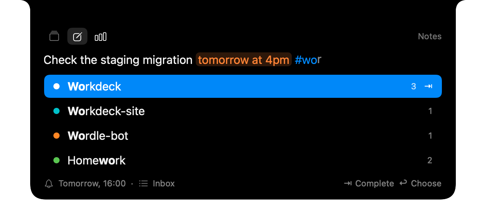

# Quick Notes

Tap the right Option key, type a line, press Return: the note is a reminder in Apple Reminders, on the Mac and, through iCloud, on the iPhone. `#` picks a project, a date in the text sets the reminder, and ⌘↩ hands the note to Claude Code or Codex in the project's folder. Completed notes are cleaned up on their own, after a copy goes to an archive.

## The Key

- **A tap of the right Option key** opens the panel: pressed and released within 0.3 s, with no other key, mouse click or scroll in between and no other modifier held. Typing `«`, `—` or `⌥←` with the right Option never opens it, and the left Option does nothing.
- Settings → Notes → **Shortcut** offers the right Command key instead, or **Custom…**: press a combination that has ⌃, or two of ⌘, ⌥ and ⇧ (⌘ or ⌥ alone would take an app's command or a typed character; Esc cancels). If another app already holds the combination, Settings says "This shortcut is taken".
- Workdeck reads the state of the right Option or Command key about 40 times a second while Quick notes is on, which needs neither Accessibility nor Input Monitoring. A recorded combination is a system hot key and needs no permission either; nothing is polled then. Turning **Quick notes** off in Settings or in the popover stops both.
- A tap while the panel is open closes it. So do Esc and a click outside; the app you were in is active again. The popover's **Notes** row opens the panel too and shows how many notes are open.

## The Panel

The panel grows out of the notch on the screen with the pointer. On a display without a notch it draws the notch's shape at the top center, whatever the "Without a notch" setting says. What the notch was showing comes back when the panel closes. The Notes icon in the expanded notch opens the same panel, and its tab bar switches to Sessions and Stats: there the panel gives the keyboard back and closes when the pointer leaves, and the note you were typing is still there when you come back to Notes. Alerts wait while you type a note and show once the panel closes.

- One line; long text wraps to at most three lines. Return saves, and the panel says "Saved · Workdeck" with when it will remind you.
- Under the text, the summary line shows what will be saved (the reminder's time and the list), and the destination line shows where ⌘↩ goes (the agent, the account and the folder). A recognized date is tinted orange in the text, so a wrong reading shows before you press Return.
- Notes without a project go to the default list (Settings → Notes → **Default list**): "Inbox", created on the first save if Reminders has none.

### Projects with `#`

A project is a Reminders list. Type `#` and a few letters: the matching lists open under the line (names that start with the letters first, then names that contain them; lists you used here lately first; at most six). The text field keeps the keyboard.

- **Tab works like a terminal.** When the matches share a longer start than you typed, Tab completes to it (shown in gray beforehand). Otherwise Tab takes the selected list, and Tab again moves to the next match. ↑↓ select, a click takes a row.
- A taken list becomes a chip in its color; it is not part of the reminder's title, and its name is never read as a date (a list called "Today" sets no reminder). Backspace right after the chip turns it back into `#name` text. A note has one project; taking another replaces the chip.
- Space takes a list only when the text after `#` is exactly its name and no other list starts with that name and a space, so names with spaces ("Shopping list") type naturally. Return takes the selected list without saving; the next Return saves.
- When nothing matches, the only row is **Create list "name" in Reminders**; Tab, Return or a click turns it into the project, and the list is created when you save the note with the next Return. Type on past the row and the text stays in the title as written: `fix issue #123 today`, `C#`.

### Dates

Dates are recognized by macOS (`NSDataDetector`): `завтра в 16`, `послезавтра утром`, `10 ноября`, `в 18:30`, `tomorrow at 4pm`. Workdeck adds two rules of its own:

1. **A time after a day.** `в 11`, `в 11:30`, `at 9`, `at 9:15` right after a recognized day sets that time: `в пятницу в 11` is Friday 11:00 (macOS alone would lose the time).
2. **Relative times.** `через 10 минут`, `через 2 часа`, `через 3 дня`, `in 45 minutes`, `in 2 hours`, `in 3 days` count from now.

How a few phrases read:

- **A date without a time** (`10 ноября`, `в пятницу`) gives an all-day reminder that rings at 09:00 that day.
- **A bare hour** reads the way macOS reads it, so one phrase never means two things: 1 to 7 without a marker is the afternoon (`в 5` is 17:00) unless written with a leading zero (`в 05:30` is 05:30); 8 to 12 and 13 to 23 are as written. `утра` and `am` keep the morning, `дня`, `вечера` and `pm` the afternoon. `ночи` is the night as said: `в 2 ночи` is 02:00, `в 11 ночи` 23:00.
- **A dot as the time separator** works after `в` or `at`: `в 11.30` is 11:30, `at 5.30` is 17:30. It needs two digits after the dot, so `в 2.5 раза` stays plain text.
- **A time that has passed** today moves to tomorrow (`в 9` typed at 14:00); a weekday that has passed moves a week. A day and month earlier in the year mean next year.
- Deleting the phrase removes the date.

### Open Notes

With the field empty, the panel lists the open notes of the lists you used here (the default list and every list a note went to): overdue first, then by due date, then undated ones from the oldest. The right column shows the due date (orange when it is today or overdue), the agent a note was given to and when, or its age.

- Typing filters the list by the notes' text and their list's name (`workdeck staging` finds the Workdeck notes about staging); `#name` limits it to one project. Return always saves what you typed as a new note.
- ↑↓ select a note, **⌘↩** gives it to its project's agent, **⌘D** marks it done. With the mouse: the circle marks it done, a row's **Give to agent** button hands it over.
- A note marked done stays in the list crossed out for 4 seconds before it is ticked in Reminders: **⌘Z** or another click on its circle takes it back. Closing the panel ticks it at once.
- **Done** under the open notes folds out what was ticked lately (up to 20, the last 30 days, until the cleanup removes them). ⌘D or the circle on one of them makes it open again.
- Right-click an open note for **Edit**, **Move to List**, **Copy** and **Delete**; **⌘E** and **⌘⌫** edit and delete the selected one.
  - **Edit** puts the note back in the line with its list as the chip and its date as text (`Nov 12 at 16:00`), marked "Editing". Change the text, the list or the date, and Return updates the same reminder; delete the date phrase to remove the reminder's date. Esc ends the edit, and whatever you were typing before comes back. Date words that were already in the note (`Prepare Friday slides`) stay text, and a repeating reminder keeps its dates.
  - **Delete** crosses the note out for 4 seconds like a tick: **⌘Z** brings it back. Deleted notes are not archived.

## Giving a Note to an Agent

**⌘↩** saves the note, then opens Terminal in the project's folder and starts the agent with the note's title as its first prompt (the date and the project are left out). The note stays open; tick it when the work is done.

- The default is **Claude Code on the main instance**. A click on the destination line or **⌘⇧↩** opens the picker: every Claude Code instance, then Codex while its tool is on and `codex` is installed, and **Change Folder…**. Your choice and the folder are remembered **per list**; the default list's choice applies to notes without a project.
- An instance that no longer exists falls back to main. A list without a folder, or whose folder is gone, asks where the agent should start: folders where Claude Code ran (from your chats and live sessions, the ones named like the project first, each with when an agent last ran there), or **Choose Other Folder…**. Esc keeps the note saved without starting anything.
- The title reaches the shell only quoted, after `--`, so a note that starts with `-` or holds `$(…)`, quotes or backticks is passed as text.
- The reminder gets one line in its notes: `Given to Claude · main, Nov 6, 14:32`. Giving the same note again within 5 seconds is ignored. If Terminal cannot be opened, the panel offers the command to copy.

## Cleanup and the Archive

- **Remove completed notes** in Settings → Notes is on by default, after 7 days (1, 3, 7, 14 or 30). It runs at launch, then every 6 hours, and once more when the first save gets access to Reminders.
- Only the lists you used here are cleaned: the default list (once it is picked in Settings or created by the first save) and every list a note was saved to or created in through the panel. In those lists every completed item goes, also ones added on the iPhone or in Reminders. No other list is touched.
- Before a reminder is removed, a line is added to `~/Library/Application Support/Workdeck/Notes Archive/YYYY-MM.md`: `- [x] Check the staging migration — Workdeck · created 2026-11-06 · done 2026-11-07`. Only once the line is written is the reminder removed; if the archive cannot be written, nothing is removed. **Show Archive** in Settings → Notes opens the folder.
- The removal syncs to all your devices. The archive is plain text for you; Workdeck never reads it back.

## Reminders Access

The first save asks for full access to Reminders: Workdeck reads the lists and open items, adds notes, and removes completed ones. If you decline, the panel says "Workdeck needs access to Reminders" with a button for System Settings → Privacy & Security → Reminders, and what you typed stays in the field. Settings → Notes → **Reminders** shows whether access is granted, not asked yet, or denied. Nothing asks at launch.

## Privacy

- A note's text lives in Reminders (your iCloud) and, after cleanup, in the archive. Nowhere else: not in Workdeck's preferences, its log, Copy Diagnostics, the feedback email or `recap.json`. Log lines name the action and the list, never the text.
- Workdeck's preferences keep only the settings, list identifiers, the agent, instance and folder chosen per list, and which reminder was given to which agent when.
- Folder suggestions use only the working directories Workdeck already reads for Chats and sessions; nothing new is read from transcripts or Codex files, and chat titles are not used.
- Nothing about notes goes over the network from Workdeck.

## Demo

The demo (Settings → General → **Try Demo**) opens the panel for a few seconds, types a made-up note with a date and `#Workdeck` into made-up lists and shows "Saved". Nothing is written to Reminders, and a note you had typed comes back afterwards.
